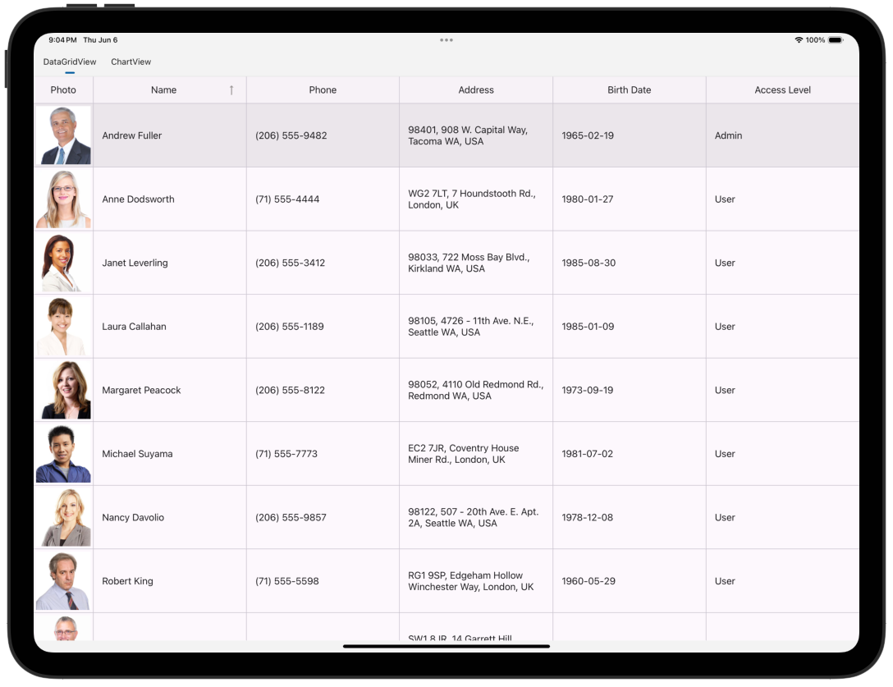
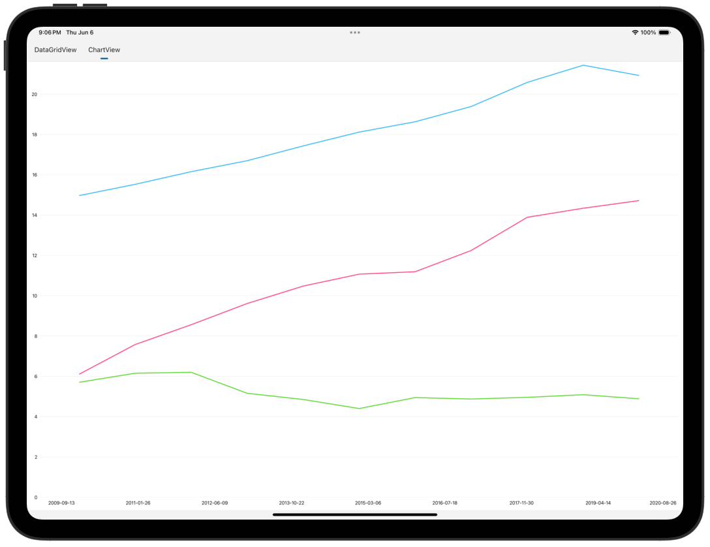
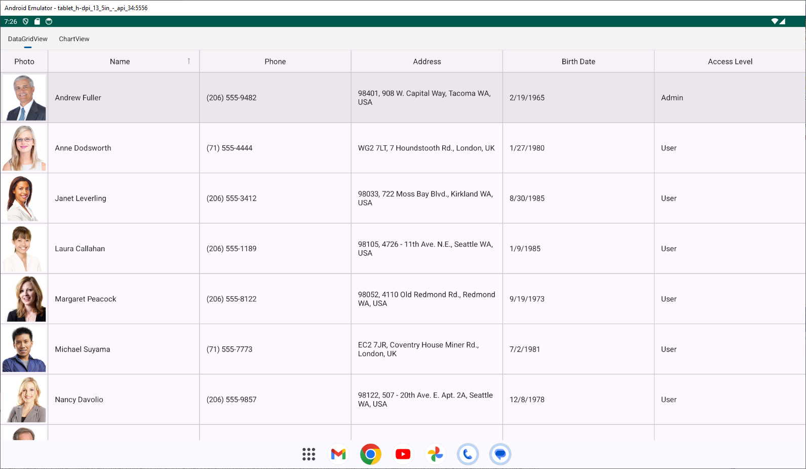
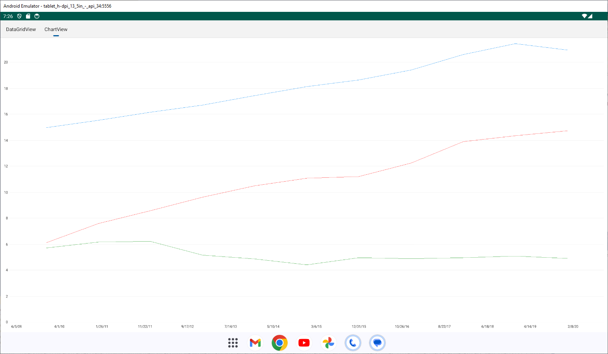

# .NET MAUI Embedding Sample App - DevExpress .NET MAUI Controls

This sample app embeds the [DevExpress .NET MAUI Controls](https://www.devexpress.com/maui/) in an Uno Platform application.

For more information on how to use the controls from DevExpress in an Uno Platform application via .NET MAUI Embedding, please visit [our documentation here](https://aka.platform.uno/maui-embedding-sample-app-devexpress).

## Platforms

This sample runs on **Android** and **iOS** only, with the native .NET MAUI embedding of Uno.Extensions (the `MauiNativeEmbedding` Uno Feature).

There is no desktop or WebAssembly target: on those targets MAUI embedding goes through `Uno.Maui.Embedding` (the `MauiEmbedding` Uno Feature), which draws MAUI controls through their Windows handlers and so needs the MAUI library to ship a Windows (`net*-windows`) build. The DevExpress .NET MAUI controls ship Android and iOS builds only.

> [!IMPORTANT]
> The DevExpress .NET MAUI packages (`DevExpress.Maui.Charts`, `DevExpress.Maui.DataGrid`) are restored from nuget.org. Without a DevExpress license key on the build machine, the build reports `DX1001` ("For evaluation purposes only. Redistribution prohibited"). See [DevExpress .NET MAUI](https://www.devexpress.com/maui/) and [devexpress.com/DX1001](https://devexpress.com/DX1001) for how to obtain and install the key.

## List of controls used in this sample

- DataGridView
- ChartView

## Sample App - Examples

- **iOS:**
  - **DataGridView**
    
  - **ChartView**
    

- **Android:**
  - **DataGridView**
    
  - **ChartView**
    

## Sample App - Issues

If you encounter any issues with this sample, please open an issue [here](https://github.com/unoplatform/uno/issues).

## What is the Uno Platform

[Uno Platform](https://platform.uno) is an open-source .NET platform for building single codebase native mobile, web, desktop, and embedded apps quickly.
For additional information about Uno Platform or if you have any feedback to share, please refer to the [README.md](../../../README.md) file in this Samples repository.
