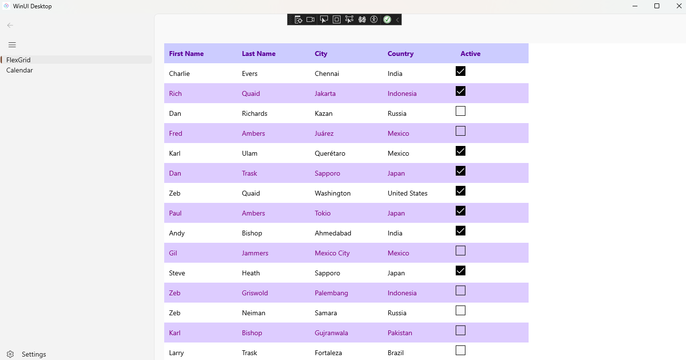
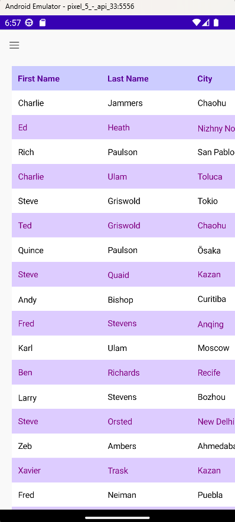

# .NET MAUI Embedding Sample App - MESCIUS ComponentOne .NET MAUI Controls 

This sample app embeds the [MESCIUS (formerly GrapeCity) ComponentOne .NET MAUI Controls](https://developer.mescius.com/componentone/maui-ui-controls) in an Uno Platform application.

For more information on how to use the controls from ComponentOne in an Uno Platform application via .NET MAUI Embedding, please visit [our documentation here](https://aka.platform.uno/maui-embedding-sample-app-grapecity).

> [!NOTE]
> In order to use the ComponentOne controls, you first need to install the ComponentOne ControlPanel following [these instructions](https://developer.mescius.com/componentone/docs/maui/online-maui/get-started.html).

## Platforms

Android, iOS and Windows, with the `MauiNativeEmbedding` Uno Feature (the native .NET MAUI embedding of Uno.Extensions).

There is no desktop or WebAssembly target. On those targets, MAUI embedding goes through [Uno.Maui.Embedding](https://www.nuget.org/packages/Uno.Maui.Embedding) (the `MauiEmbedding` Uno Feature), which runs the Windows build of the ComponentOne controls; that build needs the `C1.WinUI.*` libraries, which are not restored for those targets (`Could not load file or assembly 'C1.WinUI.Core'`).

More information: https://aka.platform.uno/feature-maui-embedding

## List of controls used in this sample
- FlexGrid
- Calendar

## Sample App - Examples

### Windows

 

### Android

 

## Sample App - Issues
If you encounter any issues with this sample, please open an issue [here](https://github.com/unoplatform/uno/issues).
