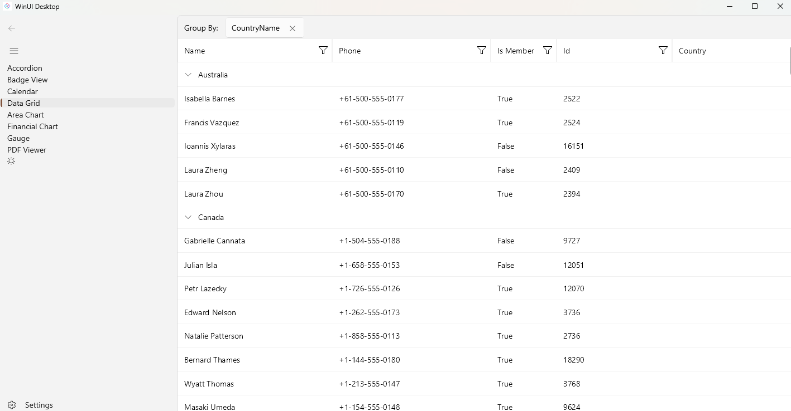
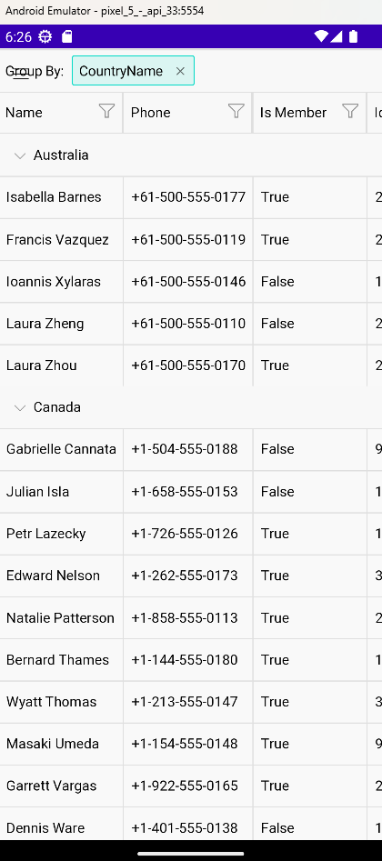

# .NET MAUI Embedding Sample App - Telerik UI for .NET MAUI

This sample app embeds the [Telerik UI for .NET MAUI](https://www.telerik.com/maui-ui) in an Uno Platform application.

For more information on how to use the controls from Telerik in an Uno Platform application via .NET MAUI Embedding, please visit [our documentation here](https://aka.platform.uno/maui-embedding-sample-app-telerik).

> [!NOTE]
> In order to use the Telerik controls, you first need to create an account and order a license to use the controls. You can find more instructions [here](https://www.telerik.com/). The `Telerik.UI.for.Maui` package is restored from nuget.org; without a Telerik license key on the build machine, the build reports `TKL002` ("No Telerik and Kendo UI License file found").
>
> The Telerik controls are commented out in this sample: to show them, uncomment the code marked `TODO: Uncomment` (including the `Telerik.UI.for.Maui` package reference in `TelerikApp.MauiControls.csproj`) and remove the placeholder labels.

## Platforms

- **Desktop and WebAssembly:** the `MauiEmbedding` Uno Feature ([Uno.Maui.Embedding](https://www.nuget.org/packages/Uno.Maui.Embedding), experimental preview), which draws the Telerik controls through their Windows (`net10.0-windows10.0.19041`) build.
- **Android, iOS and Windows:** the `MauiNativeEmbedding` Uno Feature (the native .NET MAUI embedding of Uno.Extensions).

More information: https://aka.platform.uno/feature-maui-embedding

## List of controls used in this sample
- Accordion
- Badge View
- Calendar
- Data Grid
- Area Chart
- Financial Chart
- Gauge
- PDF Viewer
- Telerik Font Examples

## Sample App - Examples

### Windows

 

### Android

 

## Sample App - Issues
If you encounter any issues with this sample, please open an issue [here](https://github.com/unoplatform/uno/issues).