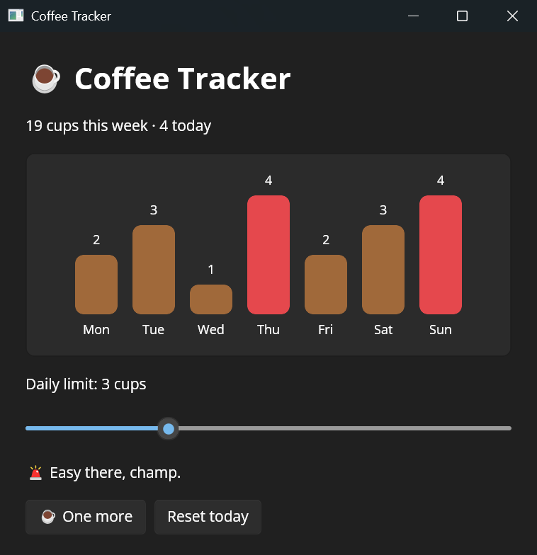

# Reactor Coffee Tracker

A small coffee tracker built with [Microsoft.UI.Reactor](https://github.com/unoplatform/Uno.microsoft-ui-reactor), the declarative, component-based C# framework for WinUI, running on Uno Platform through the [`Uno.Microsoft.UI.Reactor`](https://www.nuget.org/packages/Uno.Microsoft.UI.Reactor) package. The whole app is a single `Program.cs`: no `App.xaml`, no pages and no view models. State lives in `UseState` hooks next to the UI that uses it, and every change re-renders the component, while Reactor's reconciler patches only the real WinUI controls that changed.

The bar chart is plain Reactor elements (`Card`, `HStack`, `Border`), so it shows how far composition goes before you need a charting library. Moving the daily-limit `Slider` recolors every bar over the limit, and "One more" adds a cup to today.

## Codebase

- `src/ReactorCoffeeTracker/Program.cs` - the entry point (`ReactorApp.Run<CoffeeApp>`) and the `CoffeeApp` component
- `src/Directory.Packages.props` - the `Uno.Microsoft.UI.Reactor` package version

## What is the Uno Platform

[Uno Platform](https://platform.uno) is an open-source platform for building single codebase native mobile, web, desktop and embedded apps quickly.
